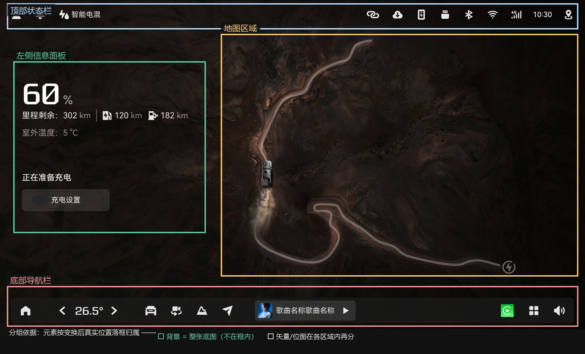

# SVG 还原为带分层的 AI 文件

## 场景

手里只有 Figma 导出的**扁平 SVG**（几百个元素挤在一个组、文字已转曲、无图层无分组 id），
需要还原成**可编辑、带图层**的 `.ai`。直接把 SVG 拖进 Illustrator 会遇到两个问题：
样子和 SVG 不一样、所有元素堆在一个图层里。本篇给出完整可复用流水线。

## 结论先行

1. **样子不对 ≠ 你的操作问题**。先看体积分布：本例 7MB 的 SVG 有 6.9MB 在 `<defs>` 里——
   4 张 base64 图片被包在 `<pattern patternContentUnits="objectBoundingBox">` 中（背景大图+照片位）。
   **Illustrator 对这种 pattern 的导入必然失真**（位置/比例错、丢图），这是"AI 打开和 SVG 不一样"的元凶。
2. **矢量用 SVG、位图用同名 PDF**。Figma 同名导出的 PDF 是完美搭档：页面尺寸=画布尺寸、
   `get_image_info` 给出每张图的精确变换矩阵；**模糊阴影已被 Figma 栅格化成图片**（AI 不支持 SVG 滤镜，
   这是唯一忠实还原路径）；渐隐蒙版已烘焙进图片的 SMask alpha 通道。
3. **"带分层"要自己重建**：先算每个元素的真实 bbox（**必须按 path 命令解析**，见坑①），
   按语义区域分组（背景/顶栏/面板/地图/底栏），层内保持原始文档顺序，再由脚本把组提升为真图层。
4. **AI 无头转换**：`Illustrator.exe -r script.jsx`；图层配对**按组名**、只遍历 `layer.pageItems`。

## 职责划分：SVG 管矢量，PDF 管位图

两个文件各司其职，**谁的内容谁负责**，不交叉：

| 内容 | 负责 | 处理方式 |
|---|---|---|
| 全部矢量元素（图标、转曲文字、公路线、色块） | **SVG** | 原样保留，文档顺序 = 堆叠顺序 |
| 背景大图、照片位 | **PDF** | 抽内嵌图（SMask alpha 已含渐隐），把 pattern 填充替换为 `<image preserveAspectRatio="none">`，保留旋转/裁剪 |
| 模糊阴影（feGaussianBlur） | **PDF** | Figma 导出 PDF 时已栅格化成图片，按 PDF 变换矩阵摆放（AI 不支持 SVG 滤镜） |
| 渐隐蒙版（mask） | **PDF** | 已烘焙进图片 alpha；AI 不认 SVG mask |
| 渐变（linearGradient）、裁剪路径（clipPath） | **SVG** | AI 能正确导入，保留在 defs |
| 分组依据 | **截图标记** | 按区域框归属（见下方示意图） |

## 分组依据（示意图）

元素按**变换后真实位置**落框归属到 5 个图层；背景是整张底图单独一组，各区域内再按「矢量 / 位图」分子组：



对应关系：顶部状态栏 → `顶部状态栏`；左框 → `左侧信息面板`；右框 → `地图区域`（子组 位图-阴影 / 矢量 / 位图-照片）；下框 → `底部导航栏`（子组 矢量 / 位图）；整张底图 → `背景`。

## 做法

完整流水线见 `scripts/illustrator/`（README 有逐脚本说明）：

1. `build_layered_svg.py` —— 解析原 SVG（命令感知 path bbox + transform 矩阵链）→ 按区域规则分组重建：
   pattern 矩形→内嵌 `<image preserveAspectRatio="none">`（保留旋转/裁剪）、滤镜阴影→PDF 栅格图、
   被裁剪的位图→按 PDF 矩阵从源图裁切。生成带命名分组的分层 SVG。
2. `convert-to-ai.jsx` —— Illustrator 无头打开分层 SVG → 按组名建真图层并移入（背景在最底）→
   删空壳图层 → 存 .ai → 导出 50% PNG24 核验图。
3. `verify-layers.jsx` —— dump 图层结构与 bounds，核对配对。
4. **双基准验证**：无头 Edge 渲染 SVG + AI 自身导出 PNG，PIL 做像素 diff
   （本例平均色差 ≈1/255，与"原图 vs PDF 渲染"的本底噪声同级）。

## 常见故障：启动时弹 "File not found"

无头启动 Illustrator 脚本时最常见的一次性故障，**先看现象再决定动作**：

| 现象 | 含义 | 正确动作 |
|---|---|---|
| 弹一次 `File not found: /xxx.jsx`（路径丢了盘符） | 旧实例未完全退出，`-r` 交接失败 | **不用重跑**——脚本通常仍会执行；看日志是否生成、是否出现 `done` |
| 进程在、CPU 几乎不动、日志文件不生成 | 旧实例占位，`-r` 根本没被接收，脚本没跑 | 必须结束旧实例后重启（不是等） |
| 日志出现 `ERROR:` | 脚本内部异常 | 按日志内容修脚本 |

- **根因**：Illustrator 是单实例应用，`-r` 由启动进程交接给实例。旧实例还没退干净时，
  交接会失败（弹一次错）或落到旧实例（脚本不执行）。
- **正确姿势**：结束旧实例 → **等进程真正消失** → 再启动 → **轮询日志**判断完成，不要靠肉眼等窗口。
  用 `scripts/illustrator/run-ai-headless.ps1` 一条命令搞定（清场 + 启动 + 轮询 + 退出码）：

```powershell
powershell -ExecutionPolicy Bypass -File scripts/illustrator/run-ai-headless.ps1 `
    -Jsx "D:\path\to\convert-to-ai.jsx" -Log "D:\path\to\_ailog.txt" -TimeoutSec 600
```

- **判据是日志不是弹窗**：日志文件是否生成、是否出现 `done`，才是"脚本到底跑没跑"的可靠信号。
- **读日志要指定编码**：日志是 UTF-8，Windows PowerShell 5.1 默认按 ANSI 读会把中文显示成乱码
  （文件本身正常）——用 `Get-Content -Encoding UTF8` 或直接 `cat`。
- **.ps1 脚本保持纯 ASCII**：Windows PowerShell 5.1 读无 BOM 的 UTF-8 脚本会按 ANSI 解析，
  非 ASCII 字符串可能直接造成语法错误（本次实测报"字符串缺少终止符"）。
- 脚本里仍要保留 `app.userInteractionLevel = DONTDISPLAYALERTS` 抑制大部分弹窗；
  但个别原生对话框（授权、文件被占用）拦不住，遇到时看日志里的最后一行定位。

## 坑

1. **path 的 `d` 里有 `H`/`V` 单坐标命令**——"把所有数字按 x,y 配对"会整体错位，一个元素的 y 值
   会跑到 x 里，bbox 全乱。必须写按 `M/L/H/V/C/S/Q/T/A/Z`（含相对命令）解析的 bbox 计算器。
   这条曾让多版分组全错。
2. **pattern + base64 图必失真**：一律替换成 `<image>`。Python ElementTree 设 `xlink:href`
   必须用 `{http://www.w3.org/1999/xlink}href` 形式（同时保留 `href`），否则序列化出的 XML
   无命名空间声明，浏览器都打不开。
3. **ET 常量少一个字符全盘皆输**：`SVGNS='{http://www.w3.org/2000/svg}'` 丢了右花括号会
   序列化出 `<http://www.w3.org/2000/svgimage>` 这种鬼标签。
4. **被替换的元素要从父节点 remove**，否则原 pattern 矩形跟着旧容器泄漏进新结构（画面重影、
   图层里多幽灵元素）。
5. **重排绘制顺序 = 改变遮挡关系**：先 dump 原始文档顺序再定图层顺序；"本来最后画、在最上层"
   的元素（半透明面板、照片）分层后必须在更靠前的图层；层内保持原顺序。
6. **PDF 里会有"计划外"的图**（本例：一张 Midjourney 海报被裁剪到只露 64×64 头像）。
   用渲染裁剪 + 像素比对确认它对应 SVG 里哪个元素，别按名字猜。
7. **`doc.groupItems` 包含嵌套组且顺序 ≠ 文档顺序**——用索引配对会把"底部导航栏"塞进
   "照片图片"层。必须按组名配对，且只遍历 `layer.pageItems`。
8. **`-r` 启动报 "File not found"**：这是**旧实例未退干净**导致的一次性交接故障，
   多数情况脚本仍会执行，别急着重跑；**判据看日志**（是否生成、是否有 `done`）。
   脚本不执行（进程在、日志不生成）时必须结束旧实例重启。完整处置见上文「常见故障」章节。
9. **AI 导出的 PNG 带出血**（画板外扩几个像素），做像素比对前要先对齐裁剪。
10. **图片按需选格式**：不透明图转 JPEG（体积约 -60%），带 alpha（渐隐/阴影）保留 PNG。

## 官方参考

- Adobe Illustrator 脚本指南（ExtendScript / IllustratorSaveOptions / ExportOptionsPNG24）
- Figma 导出说明（SVG / PDF 同时导出时内容一致，仅图片承载方式不同）
